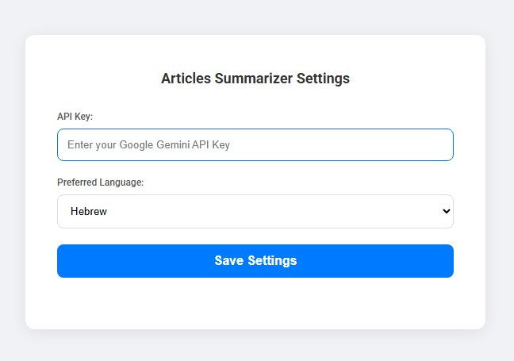
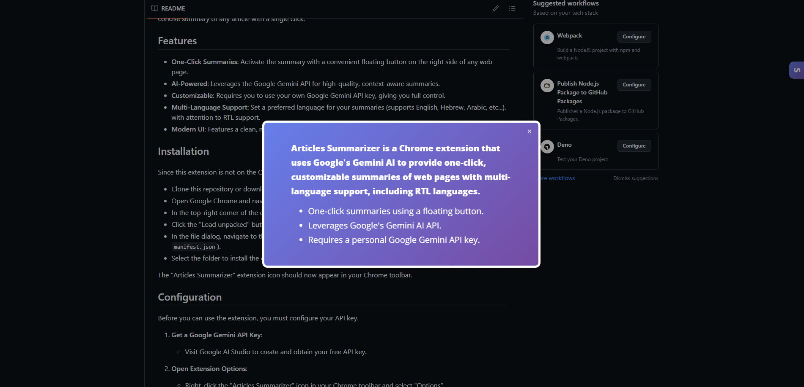
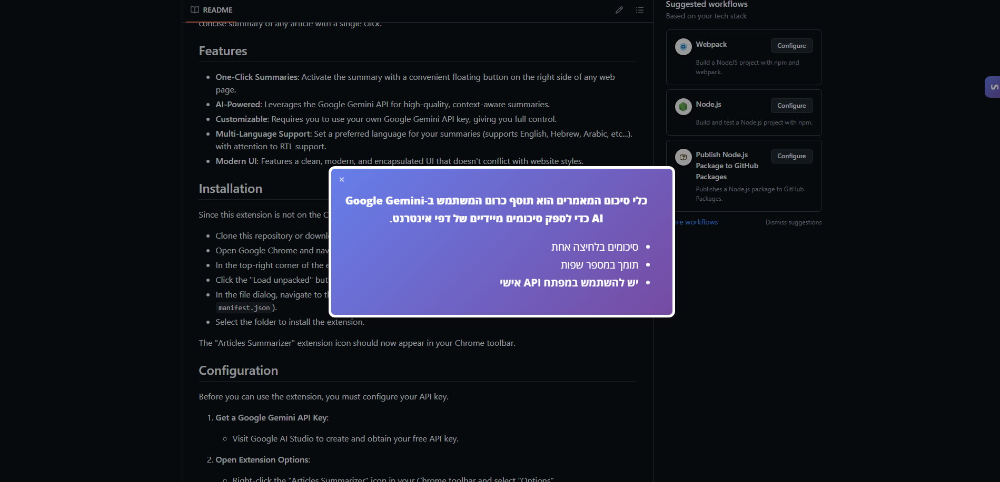
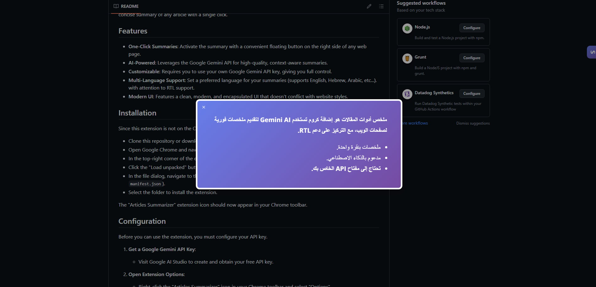

# Articles Summarizer - Chrome Extension

Articles Summarizer is a Chrome extension **with first-class RTL support**. It uses Google's Gemini API to turn a long article into a short, structured summary in your preferred language.

Click the extension icon on any article. A summary card opens on the page; click outside it, press `Esc`, or use the close button to dismiss it.

## Features

*   **One-click summaries** from the toolbar icon.
*   **On-demand page access**: the extension reads the page only when you click the icon, not on every page load.
*   **Structured output in a single request**: headline, TL;DR, bullets, expanded summary, key terms, open questions, and reading time.
*   **Built for speed**: Gemini 3.5 Flash-Lite by default, low thinking effort, and a 24-hour per-session cache.
*   **Stable by design**: request timeouts, automatic retries, clear error messages, and a 45k-character article limit.
*   **RTL aware**: Hebrew, Arabic, Persian, and Urdu summaries are rendered right-to-left.
*   **Free-tier only**: the selector offers only Gemini models with a free daily quota, and shows the quota next to each one.
*   **Safe rendering**: model output is inserted with `textContent`, never `innerHTML`.
*   **Encapsulated UI**: the summary lives in a Shadow DOM, so page styles cannot break it and it cannot break the page.

## Free-tier Gemini models (November 2026)

The extension is intentionally limited to **free-tier models**. Paid models (Gemini 4 Carbon, Neon, Hydrogen, Argon) are not offered, and an unknown/paid model ID in storage falls back to the free default.

`gemini-2.5-flash` is **deprecated**. Existing API access is limited, and starting **December 1, 2026** requests to `gemini-2.5-flash` are automatically routed to `gemini-3.5-flash-lite`. For reference, `gemini-2.5-pro` requests will be routed to `gemini-3.8-flash` on the same date.

| Model | Free quota | Best for | Notes |
| --- | --- | --- | --- |
| `gemini-3.5-flash-lite` | 500 requests/day | Summaries, extraction, high volume | Fastest and cheapest; **default here**. |
| `gemini-3.1-flash-lite` | 500 requests/day | A second high-quota fallback | Older, but gives another 500/day bucket. |
| `gemini-3.8-flash` | 20 requests/day | Best-quality summaries | Most intelligent Flash model; low thinking. |
| `gemini-3.6-flash` | 20 requests/day | Balanced quality/speed | Previous generation; another 20/day bucket. |

Free quotas are **per model per project** and reset at midnight Pacific time. That is why the selector shows the quota next to each model: when one model reaches its daily limit, switch to another free model. `gemini-3.7-flash` is deprecated and automatically routes to `gemini-3.8-flash`, so it is not listed separately.

All four models support structured JSON output, system instructions, and a 1M-token context window. They are free of charge on the Free tier; the paid per-token prices do not apply.

The extension uses the `v1beta/models/{model}:generateContent` REST endpoint with `responseJsonSchema`. Google now also offers the newer Interactions API, but a stateless one-shot `generateContent` request is simpler and cheaper for this use case.

*Model IDs and free quotas verified against Google's Gemini API documentation on November 24, 2026.*

## Installation

Since this extension is not on the Chrome Web Store, you will need to load it manually in developer mode.

*   Clone this repository or download the source code as a ZIP file and unzip it.
*   Open Google Chrome and navigate to `chrome://extensions`.
*   In the top-right corner of the extensions page, toggle the **Developer mode** switch to **On**.
*   Click **Load unpacked**.
*   Select the `src` folder (the folder containing `manifest.json`).
*   The "Articles Summarizer" icon should now appear in your toolbar.

## Configuration

Before you can use the extension, you must configure your API key.



1.  **Get a Google Gemini API key** in [Google AI Studio](https://aistudio.google.com/).
2.  **Open the extension options**: right-click the toolbar icon and choose **Options**, or open `chrome://extensions`, click **Details** on the extension, then **Extension options**.
3.  Paste the API key, choose your summary language, and pick one of the free-tier models.
4.  Click **Save Settings**.

The default model is **Gemini 3.5 Flash-Lite**: it has the largest free quota (500/day) and is the fastest option. Pick **Gemini 3.8 Flash** for richer summaries; it is also free but limited to 20 requests/day.

## How to use

1.  Open an article or any text-heavy page.
2.  Click the Articles Summarizer icon in the toolbar.
3.  Wait for the summary card. Cached pages appear almost instantly.
4.  Use **↻** to regenerate, or **×** / `Esc` / a click outside the card to close it.

## Project structure

```
src/
  shared.js      Model list, language list, limits, and shared helpers
  background.js  Gemini API calls, retries, timeouts, cache, error mapping
  ai.js          Article extraction and the summary UI
  options.html   Settings page
  options.js     Settings logic
  _locales/      English, Hebrew, and Arabic UI strings
```

### Extending without another API call

Every summary is produced by **one** Gemini request. The response schema already includes fields the current UI does not need yet:

```json
{
  "version": 1,
  "headline": "...",
  "tldr": "...",
  "bullets": ["..."],
  "summary": "...",
  "keyTerms": [{ "term": "...", "definition": "..." }],
  "questions": ["..."],
  "readingTimeMinutes": 6,
  "contentType": "news",
  "tone": "neutral"
}
```

To add a new section (for example, a "tone" badge), render the existing field in `ai.js`. No prompt change, no second request, and no extra tokens. To add a genuinely new field, add it to `SUMMARY_JSON_SCHEMA` and the system prompt in `background.js`, then render it. The parser and UI ignore fields they do not know, so old and new summaries remain compatible. To add a new model, add an entry to `MODELS` in `shared.js`; the options page and the summary meta bar pick it up automatically.

### Performance and reliability choices

*   **Article extraction** prefers `article`, `main`, and common article-body containers instead of sending the whole page (menus, ads, footers) to the model.
*   **45k-character cap** keeps requests inside the fast/cheap range while still covering long reads.
*   **Reading time is computed locally** from the full article, so it stays accurate even when the model receives the capped text.
*   **`thinkingLevel`** is `MINIMAL` for Flash-Lite and `LOW` for stronger models: summarization does not need deep reasoning.
*   **No `temperature`/`topP`**: Gemini 3.6+ ignores or rejects these sampling parameters, so they are not sent.
*   **Language guard**: the target language is locked in both system and user prompts; if the output clearly uses the wrong script, one corrective retry runs automatically (Hebrew, Arabic, Cyrillic, CJK, Devanagari, Thai). A warning chip appears if it still fails.
*   **Retries** cover 429/5xx/network failures with a short backoff; timeouts are surfaced immediately.
*   **Prompt-injection guard**: the article (title, URL, and text) is wrapped in a random marker and explicitly treated as untrusted data.
*   **URL hygiene**: only the origin and path are sent to Gemini; query strings and fragments (often containing tokens) are stripped.
*   **Session cache** is keyed by model + language + article hash and expires after 24 hours. It is cleared when the browser restarts.

## Screenshots





## Contributing

Contributions are welcome! If you have ideas for improvements or find any bugs, feel free to open an issue or submit a pull request.

## License

This project is open-source. Feel free to use and modify it as you see fit.
